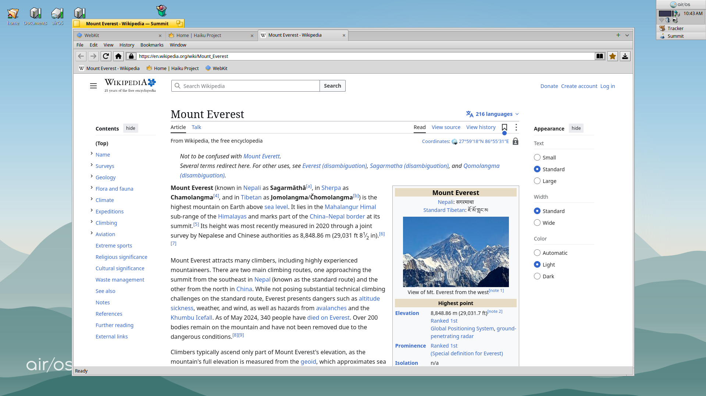

# Summit


Summit is a native WebKit browser for **air/OS and Haiku**: native controls
and Haiku's look, a compact toolbar, a multiprocess engine that renders on
the GPU, and Chrome and Firefox extensions.

**Development preview.** Summit is used every day on air/OS desktops,
laptops and ARM boards, and its web-platform scores are close to Safari's
(see [Compatibility and performance](#compatibility-and-performance)), but
it is still young: expect rough edges, and report them through the crash
page's **Send Report…** or [GitHub issues](https://github.com/airos-works/summit/issues).
Feature notes below describe the current source. Download packages identify
the commit they were built from.

There are two builds of every version:

- **air/OS** (x86_64 and arm64): [the latest release](https://github.com/airos-works/summit/releases/tag/latest).
  It uses air/OS's GPU drivers, app_server and video decoders where the
  machine has them.
- **Haiku R1/beta6** (x86_64): [the latest Haiku release](https://github.com/airos-works/summit/releases/tag/latest-haiku),
  for a stock Haiku installation without air/OS's changes. It has the same
  browser, but some features are better on air/OS: rendering and WebGL on
  the GPU, high-density screens, hardware video decoding and Web Bluetooth.
  See [Summit for air/OS and for Haiku](docs/haiku-build.md).

Choose the Summit and Summit WebKit packages for your system from the build
tables below, and install both together. Once installed, Summit updates
itself (File › Check for Updates…). `summit_webkitlegacy` is optional: it
runs WebPositive and other `BWebView` programs on Summit's engine
([BWebView on Summit's engine](docs/legacy-webview.md)).



<!-- airos-ci:latest-builds:start -->
## Latest builds

Built automatically by air/OS CI from commit `67bdc9f` on 2026-11-28 ([all files](https://github.com/airos-works/summit/releases/tag/latest)).

| Architecture | Package |
|---|---|
| arm64 | [summit-0.1.0.git20261128.0810-1-arm64.hpkg](https://github.com/airos-works/summit/releases/download/latest/summit-0.1.0.git20261128.0810-1-arm64.hpkg) |
| arm64 | [summit_webkit-1.10.1.git20261128.0810-1-arm64.hpkg](https://github.com/airos-works/summit/releases/download/latest/summit_webkit-1.10.1.git20261128.0810-1-arm64.hpkg) |
| arm64 | [summit_webkitlegacy-1.10.1.git20261128.0810-1-arm64.hpkg](https://github.com/airos-works/summit/releases/download/latest/summit_webkitlegacy-1.10.1.git20261128.0810-1-arm64.hpkg) |
| x86_64 | [summit-0.1.0.git20261128.0810-1-x86_64.hpkg](https://github.com/airos-works/summit/releases/download/latest/summit-0.1.0.git20261128.0810-1-x86_64.hpkg) |
| x86_64 | [summit_webkit-1.10.1.git20261128.0810-1-x86_64.hpkg](https://github.com/airos-works/summit/releases/download/latest/summit_webkit-1.10.1.git20261128.0810-1-x86_64.hpkg) |
| x86_64 | [summit_webkitlegacy-1.10.1.git20261128.0810-1-x86_64.hpkg](https://github.com/airos-works/summit/releases/download/latest/summit_webkitlegacy-1.10.1.git20261128.0810-1-x86_64.hpkg) |

Install with `pkgman install <file>`, or copy the file into `/boot/system/packages`. Haiku SDK: x86_64 hrev60207-3020-ga6808861bf, arm64 hrev60207-3022-ga78138217d.
<!-- airos-ci:latest-builds:end -->

<!-- airos-ci:haiku-builds:start -->
## Latest Haiku builds

Built automatically by air/OS CI from commit `67bdc9f` on 2026-11-28 ([all files](https://github.com/airos-works/summit/releases/tag/latest-haiku)).

| Architecture | Package |
|---|---|
| x86_64 | [summit-0.1.0.git20261128.0810-1-x86_64.hpkg](https://github.com/airos-works/summit/releases/download/latest-haiku/summit-0.1.0.git20261128.0810-1-x86_64.hpkg) |
| x86_64 | [summit_webkit-1.10.1.git20261128.0810-1-x86_64.hpkg](https://github.com/airos-works/summit/releases/download/latest-haiku/summit_webkit-1.10.1.git20261128.0810-1-x86_64.hpkg) |

For a stock Haiku installation, not air/OS. Install the packages together with `pkgman install ./<file>...`, which also installs what they need from HaikuPorts. Haiku SDK: the R1/beta6 release (r1~beta6_hrev59866_79), not air/OS.
<!-- airos-ci:haiku-builds:end -->

## Compatibility and performance

| Measure | Summit | For comparison |
| --- | --- | --- |
| Interop 2026, every labelled test on current WPT (21 Nov) | **99.94** | |
| Interop 2025, same run | **96.85** | |
| Interop 2024 (25 Nov) | **99.13** | Safari Technology Preview 257: 98.35 on the same tests |
| [HTML5test](docs/html5test-2026-11-18.md) (18 Nov) | **565 / 588**; 577 with [sensors](docs/sensors.md#html5test) (28 Nov) | Chrome 158: 572, Firefox 160: 547 |
| [Speedometer 3.1](docs/performance.md) with profile-guided optimization (7 Nov) | 10.2 on a Threadripper 1950X; 5.89 on a ROCK 5 | 8.6 and 4.8 without it |

The Interop runs and what is left are in
[#243](https://github.com/airos-works/summit/issues/243) and
[#279](https://github.com/airos-works/summit/issues/279); most of the
remaining 2025 points are Storage Access and WebRTC tests. Summit is
tested on x86_64 (NVIDIA through NVK and Zink, AMD and Intel graphics,
desktops and laptops) and arm64 boards (ROCK 5, Raspberry Pi 4, Cubie A7S).

## Browser features

**Tabs, windows and pages**

- Tabs that can be dragged between windows, pinned, muted, grouped, and
  [unloaded](docs/tab-discarding.md) (by hand, or when memory runs low);
  windows with many tabs shrink, scroll and list them. A tab that plays
  sound shows a speaker, and its menu has Pause, Previous and Next.
- Saved sessions, back/forward history with history menus on the buttons,
  page find, configurable search, per-site zoom, and downloads that resume
  after a lost connection.
- [Browser profiles](docs/browser-profiles.md), each with its own windows,
  history, bookmarks, extensions and website data.
- [Bookmarks in folders](docs/bookmarks.md), on the bookmarks bar (folders open
  as menus, drag to reorder or drop tabs) and in the Bookmarks menu, edited on
  the Bookmarks tab or from the star; import from WebPositive, Firefox
  (places.sqlite or HTML) and Chrome with their history, and export as
  bookmarks HTML. A [Reading List](docs/browser-ui.md#reading-list-156) keeps
  offline copies of pages to read later.
- [Printing, Save as PDF, spell checking, Picture in Picture, websites
  installed as apps](docs/issue-fixes-2026-10-19b.md),
  [Save Page As](docs/browser-ui.md#save-page-as-152) (a web archive, the
  source or the text), a [Share menu](docs/browser-ui.md#web-share-153), an
  autoplay setting, and blocked pop-up notices.
- [AutoFill](docs/form-controls.md#autofill-contact-info-addresses-and-payment-cards-149)
  for contact details, addresses, payment cards and form history; saved
  passwords in the Haiku key store; [passkeys](docs/webauthn-passkeys.md) kept
  by Summit and USB security keys.
- [Page translation](docs/page-translation.md) that runs on the computer,
  [Reader mode](docs/reader-mode.md), a bundled [PDF viewer](docs/pdf-viewer.md),
  and Edit › Speech to read a selection aloud.
- A page for crashed or hung tabs, with a [crash report](docs/crash-reports.md)
  that can be sent as a GitHub issue.

**Privacy and security**

- [Private windows and browsing-data controls](docs/browser-privacy.md), and
  [cross-site tracking prevention](docs/browser-privacy.md#cross-site-tracking-prevention-141-1-november-2026)
  with storage-access prompts and exceptions.
- [Warnings before fraudulent and malicious websites](docs/safe-browsing.md),
  [HTTPS-First](docs/web-apis.md#https-first-160),
  [certificate warnings and connection details](docs/certificate-warnings.md),
  and native [permission prompts](docs/site-permissions.md) for the camera,
  microphone, location, notifications and cross-site cookies.
- [User-agent presets](docs/user-agent.md) in Preferences › Compatibility:
  Chrome, Firefox, Safari and Edge identities for sites that reject Summit.

**Look and accessibility**

- Haiku's look throughout: unstyled [form controls](docs/form-controls.md)
  and scroll bars are drawn like Haiku's own, and the native
  [color, date and time pickers](docs/native-form-pickers.md) are Haiku
  controls.
- [Dark mode](docs/dark-mode.md): with air/OS's dark mode on (Screen
  preferences), websites get `prefers-color-scheme: dark`, switching live in
  open tabs.
- Pages at the screen's density on [high-density screens](docs/hidpi.md),
  including fractional scales, and [bundled emoji fonts](docs/emoji.md) with
  color, skin tones, flags and joined sequences.
- [Screen readers](docs/accessibility-aids.md#screen-readers-226) through
  air/OS's accessibility interface, caret browsing, a minimum font size,
  Reduce Motion, Increase Contrast and page color overrides.
- A [touch layout](docs/mobile.md) for air/OS Mobile and for 2-in-1s folded
  into tablets.

**Extensions**

- [Installation from the Chrome Web Store and Firefox Add-ons](docs/extension-stores.md)
  with their signatures checked, native permission review, toolbar actions and
  popups, side panels, developer-tools pages, containers and tab groups, and
  restoration of approved extensions across restarts. Local CRX, ZIP/XPI and
  folder packages, and the web extension inside a Safari extension's
  `.app`, are also supported.
- Published uBlock Origin and Dark Reader have passed native runtime suites;
  1Password has verified sign-in, inline filling, and
  [Web Authentication/passkey integration](docs/webauthn-passkeys.md);
  [chrome.debugger](docs/webextensions-debugger.md) is there for extensions
  such as Claude in Chrome. This is not a promise that every Chrome, Firefox,
  or Safari extension works. See the [verification record](docs/STATUS.md) and
  [1Password notes](docs/webextensions-1password.md) for tested versions and
  limitations.

**For developers**

- [Developer tools](docs/developer-tools.md), docked under or beside the page
  or in a window: Elements (the live DOM, styles, the box model, Inspect
  Element), Console, Sources (breakpoints, pretty printing, source maps),
  Network (with throttling), Performance (a flame chart, CPU and memory),
  Storage and Responsive Design Mode, plus View › View Page Source (Alt+U).
- [WebDriver](docs/webdriver.md) through `summitdriver`, for Selenium,
  WebdriverIO and the web-platform tests.
- A [built-in MCP server](docs/mcp.md) (Preferences › Developer, off by
  default) that lets debugging tools such as Claude Code inspect tabs, pages,
  processes, memory, rendering, media and extensions on the machine itself.
- [Updates from inside the browser](docs/updates.md): File › Check for
  Updates… and a daily check find newer builds of the release for your
  system, list what changed, and Install and Restart installs the summit and
  summit_webkit packages together and reopens your windows and tabs.

## Web features

| Area | Current implementation |
| --- | --- |
| Rendering | Modern WebKit HTML/CSS/JavaScript, drawn with Skia and composited on the GPU ([GPU compositing](docs/gpu-compositing.md)) when a suitable EGL/GLES driver is available; software rendering otherwise. JavaScriptCore with its JITs, built with profile-guided optimization. |
| Graphics | [WebGL and WebGL2](docs/webgl.md); [WebGPU](docs/webgpu.md) on Dawn's Vulkan backend where the machine has a Vulkan driver; GPU-backed 2D canvases on x86_64; [2D hit regions](docs/canvas-hit-regions.md), main-thread and worker OffscreenCanvas, ImageBitmap transfer, and display-p3 canvases. |
| Images | Standard web formats plus JPEG XL and HEIC decoding, and JPEG XR decoding/encoding. |
| Media | HTML audio/video, [MediaSource streaming](docs/streaming-media.md) for MP4, WebM, ADTS AAC, MPEG audio and MPEG-TS, [native HLS](docs/streaming-media.md#native-hls-115-30-october) (live, AES-128) and direct [MPEG-DASH](docs/dash-playback.md). Hardware decoding where air/OS has a decoder for the machine (NVIDIA NVDEC, AMD, Rockchip, Allwinner and Raspberry Pi video engines). Media Session and Picture in Picture. |
| Encrypted media | [Clear Key EME](docs/encrypted-media.md) with temporary sessions for MP4 (`cenc`, `cbc1`, `cens`, `cbcs`) and encrypted WebM. Widevine, PlayReady, FairPlay, and persistent licenses are unsupported; Summit says so when a page asks for them. |
| Calls and real time | [WebRTC](docs/webrtc.md) (camera, microphone, screen sharing with the computer's sound, data channels), Web Audio, MediaRecorder (MP4 and WebM), [WebCodecs](docs/webcodecs.md) (VP8, VP9, H.264), and [WebTransport](docs/webtransport.md) over HTTP/3. |
| Devices | [WebUSB](docs/web-platform-issues.md), [Web Bluetooth](docs/bluetooth-transport.md), [Gamepad and Pointer Lock](docs/web-apis.md), geolocation from air/OS's location service, and USB security keys (CTAP2 and U2F). |
| Apps and storage | Notifications and Web Push (Summit keeps running without windows to receive them), service workers, the origin private file system, the Cookie Store API, the Navigation API, the async Clipboard API, Web Share and speech synthesis ([Web APIs](docs/web-apis.md)). |
| Integration | Native fullscreen, approved external-app and website protocol handlers, and Web Authentication with [passkeys kept by Summit](docs/webauthn-passkeys.md) in the key store (password-manager extensions first). |

[Web-platform notes](docs/web-platform-issues.md) document the supported subsets.
Device access requires a secure context and user approval. Web Bluetooth
supports the top-level origin and same-origin children, session-only grants,
and the air/OS stack's existing LE connection facilities; new pairing and
advertisement observation APIs are not implemented.

## Build and run

Use matching application and engine packages from the same build table. Native
engine builds need the air/OS/Haiku toolchain and private dependencies described
in the [engine notes](engine/README.md). air/OS CI
([airos-works/airos-ci](https://github.com/airos-works/airos-ci)) makes both
builds: the air/OS one against the air/OS SDK, and the Haiku one against an SDK
made from the R1/beta6 release itself (`AIROS_TARGET=r1beta6`). CI builds the
engine with a profile-guided optimization profile (`engine/pgo.json`) that is
retrained from time to time.

The full multiprocess, extension-enabled development build is:

```sh
bash tools/build-webkit-in-vm.sh --modern-extensions all
bash tools/build-modern-browser-in-vm.sh --browser --bundle --modern-extensions
```

The scripts record the resulting bundle path. Copy the entire bundle and run
its `run-browser.sh`; it carries the matching engine, process helpers, private
libraries, source archive, and build manifest. See the [native test VM](docs/VM.md);
released builds are CI's packages (above).

For UI development the Makefile builds against an engine whose API headers
(`develop/headers/WebKit/WebKitView.h`) and library are under `WEBKIT_PREFIX`,
such as the staging directory of an engine build (the `summit_webkit` package
carries the library only):

```sh
pkgman install gcc make
make -j6 WEBKIT_PREFIX=/path/to/engine/staging
make check
./build-modern-haiku/Summit
```

Portable tests also run on Linux. Install a C++ compiler, CMake, and OpenSSL
development headers/libraries, then run:

```sh
cmake -S . -B build-host -DCMAKE_BUILD_TYPE=Debug
cmake --build build-host -j6
ctest --test-dir build-host --output-on-failure
```

The Interop and Speedometer kit that produced the numbers above is in
[tools/interop2026](tools/interop2026/README.md).

## Using Summit

Haiku's default Command modifier is **Alt**: Alt+L focuses the address field,
Alt+T opens a tab, Alt+W closes it, Alt+Shift+T reopens the last closed tab,
Alt+D bookmarks the page, Alt+F finds text, and Alt+R reloads. Ctrl+Tab cycles
tabs. Choose the search provider in Preferences.

Profiles live in `~/config/settings/Summit/`; File › New Window in Profile
opens another one, and `--profile /path` runs Summit on a separate profile
folder. Downloads default to `~/Downloads/`.
[Privacy notes](docs/browser-privacy.md) describe storage and private windows.

The application icon is the native vector resource `resources/Summit.hvif`.
Editable toolbar artwork, generated image sizes, and regeneration commands
are documented in [resources/artwork](resources/artwork/README.md).

See [current verification](docs/STATUS.md),
[requirements and remaining work](docs/REQUIREMENTS.md),
[the Safari gap review](docs/safari-gap-review-2026-11-01.md), and
[performance measurements](docs/performance.md) for implementation evidence.

Summit's application code is MIT-licensed. WebKit and the Haiku port retain
their upstream per-file licenses; engine changes are in `engine/patches`.
Bundled dependencies retain their own licenses and notices.
