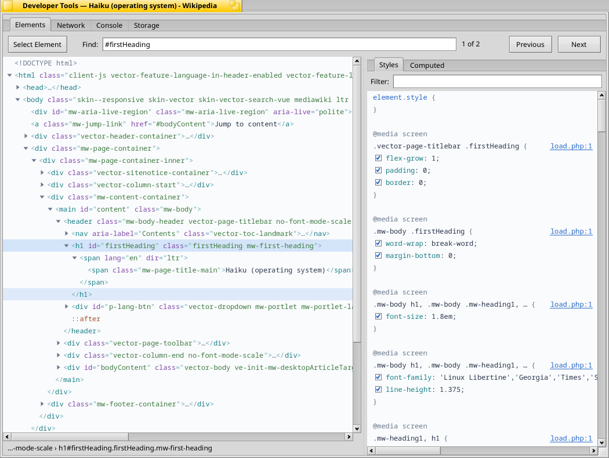

# Developer tools: Elements, Network, Console, Storage and page source

Added 30 September 2026. The first pass (morning): what a page asks of the
network, and what it writes to its console. The Storage tab (afternoon): the
page's local and session storage and its cookies. The Elements panel and
View Page Source followed on 19 October 2026 (issue #76). Sources with a
debugger, and timelines, are not part of it (see [Not done](#not-done)).



## What the user sees

**View › Developer Tools** (Shift+Alt+I, or *Developer Tools* at the end of a
page's context menu) opens a window for the current tab, titled with the
page's title. Each tab has its own; the command brings an open one forward.
The window closes with its tab. Its tabs are **Elements** (shown first, as in
other browsers), **Network**, **Console** and **Storage**.

The tools record from the moment they open. A page that has already loaded
shows nothing until it asks for something again; reload it to see everything
it loads. The Elements panel is the exception: it reads the page's document
as it is when the panel is first shown.

### View Page Source

**View › View Page Source** (Alt+U, or *View Page Source* in a page's context
menu) opens a window with the current page's HTML **as the server sent it**,
not the DOM that scripts have changed since: on example.com it has one
paragraph where the page shows six, which a script added. The source is in
the fixed font, coloured as HTML (XML, JSON, scripts and style sheets by
their own kind), with line numbers. *Wrap lines* is on at first. **Find**
(Alt+F) marks every match as it is typed and counts them; Enter, *Next* and
Alt+G go to the next, Shift+Enter, *Previous* and Shift+Alt+G to the one
before. The line under the text gives the address, type, size and number of
lines. The secondary button copies the selection or all of it. Each command
opens a window of its own, which stays when the page moves on.

### Elements

On the left, the page's DOM as a tree, in the fixed font and in the colours
of Kiri's HTML: the doctype, then `<html>` with `<head>` closed and `<body>`
open and selected, as in other browsers. A triangle opens and closes an
element (with Shift, everything in it). An element whose only content is a
short text shows it on its line (`<title>Example Domain</title>`); a closed
one shows `…` before its end tag. Text nodes are in quotes; comments,
`::before` and `::after`, `#shadow-root (open)`, a frame's `#document` and a
template's `#document-fragment` are shown where they are. **The tree follows
the page**: nodes the page adds, removes or changes (attributes, text) change
in it at once, and after a reload the node that was selected is found again.

- **Selecting**: a click, or the arrow keys (Left closes or goes to the
  parent, Right opens or goes in), Page Up and Down, Home and End. The line
  under the tree gives the path to the node (`html › body › div#main ›
  h1.title`). Selecting an element makes it `$0` in the Console.
- **Hovering** a line has the page highlight the node: its content, padding,
  border and margin in Web Inspector's colours. (Without Web Inspector's
  label of tag, size and role: see [Not done](#not-done).)
- **Finding** (Alt+F, or the *Find* field): text, a CSS selector or an
  XPath, found as it is typed (once typing pauses for 0.3 s); Enter selects
  the next match ("2 of 7"), Shift+Enter the one before.
- **Editing**: a double click on an element's attributes edits them all as
  text (`id="main" class="note"`: those left out are removed); on the tag
  name renames the element; on a text or a comment edits it. Enter keeps the
  change, Escape drops it, clicking elsewhere keeps it. **Delete** (or
  Backspace) removes the selected node and selects the next one. The
  secondary button's menu also has Add Attribute, Edit as HTML (the node's
  outer HTML in an editor; Apply replaces it in the page), Copy Outer HTML
  (also Alt+C), Copy Selector, Expand All, Collapse All, Scroll into View,
  and Undo and Redo of these changes (also Alt+Z and Shift+Alt+Z).
- **Select Element** (the button, Shift+Alt+C in the tools, or **View ›
  Select Element in Page**, Shift+Alt+C, in the browser): the page highlights
  what is under the pointer as it moves, and the element clicked is selected
  in the tree, which comes forward. Escape stops it.
- **Inspect Element**, at the end of every page context menu, opens the tools
  on the element under the pointer (inside frames of the page's own site and
  open shadow roots too).

On the right, tabs for the selected element:

- **Styles**: its `element.style` (which takes new declarations), the rules
  that match it from the strongest down with `@media` and the like above
  them, presentational attributes, the browser's own rules (*user agent
  style sheet*), then the rules of `::before` and `::after`, then what it
  inherits from each ancestor (*Inherited from div#main*, only properties
  that are inherited). Each rule gives its style sheet and line
  (`site.css:12`, or the page's address for a `<style>`); a click on it opens
  the style sheet at that line in a source window. A declaration that does
  not apply is struck through: overridden by a stronger one (shorthands and
  their parts are compared), switched off, or not understood (in red). Each
  declaration of the page's own rules has a box that switches it off and on;
  a double click edits it (an empty text removes it); a double click on a
  rule's first or last line adds a declaration. The page repaints at once:
  this is the page's style sheet being changed, as other browsers do it.
  *Filter* shows the declarations whose property or value contains a text.
  A declaration of the element's own rules that uses `var()` shows what it
  came to after it, in grey (`color: var(--text); = rgb(51, 51, 51)`).
  A colour (`#36c`, `rgb()`, `rgba()`, the basic names, or a `var()` that
  comes to one) has a swatch before it; clicking the swatch of a declaration
  that can be changed opens a colour picker whose OK sets it (as `#rrggbb`,
  keeping its alpha and `!important`).
  A double click on a rule's selector edits it (`CSS.setRuleSelector`; the
  page's own rules only), and **+** (or New Style Rule in the secondary
  button's menu) adds an empty rule for the selected element's selector to
  the page's inspector style sheet, made the first time
  (`CSS.createStyleSheet`, `CSS.addRule`), ready for declarations.
  **:hov** forces `:active`, `:focus`, `:focus-visible`, `:focus-within`,
  `:hover` or `:visited` on the selected element (`CSS.forcePseudoState`):
  the page draws it in that state and its rules for it are listed; the
  button shows what is forced (`:hover :focus`). The page forgets them when
  the tools close or it moves on.
  The secondary button also has Copy Declaration, Copy Rule and Show in Style
  Sheet.
- **Computed**: the box model (margin, border, padding and content, with the
  `position` offsets around them for a positioned element) and the computed
  value of the properties the element's rules set or it inherits; *Show all*
  lists all of them. *Filter* as above.
- **Accessibility**: the role and label assistive technology is given, then
  the element's states (asked for only while the tab shows).
- **Event Listeners**: the listeners its events reach, its own first, then
  those of the elements above it, the document and `window`
  (`DOM.getEventListenersForNode`): event, where it is registered, the
  handler's name (and script and line when known), and capture or bubble,
  once, passive, an `on…` attribute, or switched off. Test action:
  `elements-tab listeners`; the state's `elements.listeners` lists them.


### Network

One row for each request: name (the last part of the address), status,
method, type, domain, size, time and what started it (`app.js:10`, or the
document). A redirect is a row of its own, in grey, followed by the request
it led to. Failed requests and answers of 400 and above are red. The columns
sort and resize; the line under the list counts the requests and their bytes.

Above the list: **Clear**, **Preserve log**, a menu of types (all, fetch and
XHR, documents, style sheets, scripts, images, fonts, other), a filter on
the address, **Disable cache** (everything comes from the network while
the tools are open: `Network.setResourceCachingDisabled`), the **Request**
menu and **Export HAR…**. The Request menu has **Copy as cURL** (the
selected request as a `curl` command line: method, headers and body, each
argument in single quotes; HTTP/2's pseudo-headers and `Content-Length` left
out), **Replay** (the request again from the page with `fetch()`: its
method, body and the headers a page may set; it appears as a new row),
**Block** its address (without the query; requests to it fail while the
tools are open, through `Network.addInterception`; the summary counts the
blocked addresses) and **Unblock All**; and **Export HAR…** (the
requests listed, in their order, as an HTTP Archive 1.2 file named after the
page's host: headers, query, posted data, the response bodies the tools have
read, sizes, timings as wait and receive). Test actions: `copy-curl`,
`export-har PATH`, `disable-cache on|off`, `replay`, `block-url PART`,
`unblock-all`; the state's `network.curl` is the selected request's command,
`cacheDisabled` and `blocked` the rest.

Selecting a request shows three tabs below the list:

- **Headers**: address, method, status, type, remote address, protocol,
  size, when and how long; where the time went (DNS lookup, connecting,
  TLS, waiting for the first byte, receiving; a reused connection has no
  lookup or connecting) from the response's timing; then the response's
  headers and the request's (as they went over the network, so with the
  cookies and the user agent). HAR exports carry the same phases.
- **Request**: the body that was sent, if any.
- **Response**: what the server answered.
- **Messages**: for a WebSocket (a row of its own from when it opens, type
  WebSocket, status 101), each message as it comes: ↑ sent or ↓ received,
  the time since the socket opened, the text (binary, close, ping and pong
  frames by their size), and errors on the socket; the latest 2000 are kept.
  Test action: `detail messages`; the state's `network.messages` is the text.

Bodies are shown in the fixed font and coloured by what they are. **JSON,
XML and HTML are laid out for reading** while *Format* is ticked; untick it to
see the bytes as they came. **Copy** puts the text on the clipboard as it is
shown, so formatted if it is formatted. A body is recognised by its
`Content-Type` and, where that says little (`text/plain`,
`application/octet-stream`, nothing), by its content. JSON that is not valid
is shown as received, and says so. Pictures are shown as pictures; other
binary data as a hexadecimal dump. *Wrap lines* and the secondary button's
menu (Copy, Copy All, Select All) work on every text.

### Console

The page's messages in the fixed font, **coloured by severity**: errors in
bold red on a red tint, warnings in amber on a yellow tint, information in
blue, debug messages in grey, `console.log()` in the text colour. Each has a
mark of its own shape and colour in the margin, its time beside it and its
place in the page's sources (`app.js:41:17`) after it. Errors, warnings,
`console.trace()` and failed assertions show their call stack. Objects and
arrays are shown by their preview (`{id: 7, name: "Ann", …}`), `%s`, `%d`,
`%o` and the rest are substituted, a repeated message is counted (`×3`) and
the members of a `console.group()` are indented.

Clicking a message or result that shows objects opens them in a **tree** to
the right of the log (a single object opens at once). Opening a row asks the
page for that object's properties (`Runtime.getDisplayableProperties`):
each shows its value as the log would, an object can be opened in turn,
getters show `(…)` and internal slots such as `[[Prototype]]` and
`[[Entries]]` are listed after the object's own. An object the page has let
go of (after it moved on) says so. The tree pane can be dragged narrower or
collapsed. Test actions: `devtools-do inspect N|last` (the Nth entry from 0)
and `devtools-do expand TEXT` (the first row starting with TEXT); the state's
`console.objects` lists the rows shown, indented by depth.

Above the log: **Clear**, **Preserve log**, a check box for each level to
show (**Errors**, **Warnings**, **Info**, which is `console.info()` and
`console.log()`, and **Debug**) and a filter on the text. The line under the
log counts the messages, the errors and warnings among them, and those the
levels or the filter hide.

The field at the bottom runs JavaScript in the page; Up and Down bring back
earlier lines. What was typed and what it gave are shown in the log whatever
levels are ticked.


### Storage

The left of the tab lists **Local Storage**, **Session Storage** and
**IndexedDB**, each with the origins of the page's frames (the page's own
first, then those of frames from other sites), and **Cookies**. Choosing an
IndexedDB origin asks for its databases (`IndexedDB.requestDatabaseNames`,
`requestDatabase`); their object stores then appear under it as
*database › store*, and choosing one lists its first 200 entries, key and
value as the Console shows them (`IndexedDB.requestData`); **Clear All**
empties the store (`IndexedDB.clearObjectStore`). Test action:
`storage-select indexeddb ORIGIN` or `indexeddb ORIGIN|DATABASE|STORE`.
Choosing one shows it on the right:

- **Storage**: a row for each key, with its value on one line. The selected
  item's value is shown whole below the list, in the same viewer as a
  response body: JSON laid out and coloured (*Format*), *Wrap lines*,
  **Copy**. The *Key* and *Value* fields under it are filled from the
  selected item; **Save Item** sets the key to the value in the page's
  storage, adding it if it is new.
- **Cookies**: every cookie the page's addresses are sent, HttpOnly ones
  included: name, value, domain, path, when it expires (*Session* for those
  that end with the session), size, HttpOnly, Secure and SameSite. The
  selected cookie's value is shown below, and its *Name* and *Value* fill
  the fields under it: **Save Cookie** sets it with what they say (a new
  name replaces the cookie), keeping its domain, path, expiry and flags
  (`Page.setCookie`); with no cookie selected it adds a session cookie for
  the page's host, Secure on an https page.

**Refresh** reads the storage again, **Delete** removes the selected item or
cookie, **Clear All** removes every item of the storage shown, or every
cookie listed. The filter shows the rows whose key or value (a cookie's name,
value or domain) contains the text. The line under the list counts the items
and their bytes.

The list follows the page: an item the page sets, changes or removes changes
in the list at once, a frame from another site adds its origin, and after the
page (re)loads what is shown is read again. A page that changes its site
starts a new list. A storage is only read from the page while the Storage tab
is shown.

### Preserve log

Without it, a navigation of the page empties the list of requests and the
console, so that they show the page that is there. The new page's own
document is the first row, not the last of the old.

With it, nothing is removed: the requests of the pages before stay in the
list, and the console marks where the page changed (*Navigated to …*). The
page is also told to keep the bodies of what it loaded, so that a response of
an earlier page can still be read, as long as the navigation stayed in the
same process. `console.clear()` does not clear a console that is kept.

The two check boxes are independent, and **Clear** empties its own panel at
any time.

## How it works

```
page (WebProcess)          UIProcess                          browser
 Network, Console,   -->   WebPageInspectorController   -->   BWebKitInspectorSession
 Page, Runtime agents      (target router)                     queue, one notification
                                                                    |
                                        DevToolsWindow's thread:  devtools::Session
                                                                    |
                                                          NetworkPanel, ConsolePanel
```

- **Engine.** Nothing new is measured: the tools listen to WebKit's own Web
  Inspector protocol. `BWebKitInspectorSession`
  (`Source/WebKit/UIProcess/API/haiku/WebKitInspector.{h,cpp}`) connects a
  frontend channel to the page's `WebPageInspectorController`, the way a
  remote Web Inspector does. The page's messages are queued for the host and
  announced by one `B_WEBKIT_INSPECTOR_MESSAGES` per batch, because a busy
  page sends thousands and a window's port holds two hundred. Connecting
  turns on the *developer extras* of the page's preferences, without which
  console messages never leave the web process; the last session to end
  turns them off again. With no tools open the engine does nothing it did
  not do before.
- **Model.** `src/core/DevTools.{h,cpp}` reads the protocol into a list of
  requests and a list of console entries, and says what changed. It enables
  `Page`, `Network` and `Console` in every target, which is the page's
  process: a navigation to another site starts in a new process, whose target
  is paused (`Target.setPauseOnStart`) until its requests are being recorded,
  so the new page's document is not missed. Bodies come from
  `Network.getResponseBody`: at once for documents and for what scripts fetch
  (up to 2 MiB each, since those are what is read and the page forgets them
  when it moves on), and when they are selected for everything else. At most
  128 MiB of bodies, 5000 requests and 10000 console entries are kept.
- **Formatting.** `src/core/DevToolsFormat.{h,cpp}`. JSON is validated with
  nlohmann's parser and then re-indented token by token, so that no number or
  escape is rewritten (`12345678901234567890`, `1.0` and `1e3` stay as the
  server wrote them, which parsing and printing again would not guarantee).
  XML and HTML are tokenised and written one element a line; HTML knows void
  elements, end tags that may be omitted, inline elements, and leaves `pre`
  and `textarea` alone and the text of `script` and `style` as it is, moved
  to the element's indentation.
- **Storage.** The model also enables `DOMStorage` in each target and asks
  `Page.getResourceTree` for the origins of the page's frames (then follows
  `Page.frameNavigated`). A storage is read with
  `DOMStorage.getDOMStorageItems` and changed with `setDOMStorageItem`,
  `removeDOMStorageItem` and `clearDOMStorageItems`; the page's own changes
  arrive as `DOMStorage.domStorageItem{Added,Updated,Removed,sCleared}`
  events. Cookies are `Page.getCookies` (the cookies of all the page's
  resources, through the network process, so HttpOnly ones too) and
  `Page.deleteCookie` with the cookie's name and an address it is sent to.
  No engine change was needed.
- **Elements.** `src/core/DevToolsElements.{h,cpp}` (`devtools::DOMModel`)
  belongs to the session, which sends its commands to the page's target and
  gives it their answers and the page's `DOM.*`, `CSS.*`, `Inspector.inspect`
  and load events. Nothing is asked until the panel is first shown, so tools
  opened on another panel cost the page nothing more. Then: `Inspector.enable`
  (what the picker chose arrives as `Inspector.inspect`), `CSS.enable` (the
  style sheets, `CSS.styleSheetAdded`), `CSS.getSupportedCSSProperties` (which
  properties inherit, and the longhands of each shorthand) and
  `DOM.getDocument`. The model keeps the nodes the page has told it of, by
  their `nodeId`, with their children once `DOM.requestChildNodes` (on
  opening a node) or `DOM.setChildNodes` has given them, and follows
  `DOM.childNodeInserted`, `childNodeRemoved`, `childNodeCountUpdated`,
  `attributeModified`, `attributeRemoved`, `inlineStyleInvalidated` (then
  `DOM.getAttributes`), `characterDataModified`, `shadowRootPushed` and
  `Popped`, `pseudoElementAdded` and `Removed`, and `documentUpdated` (the
  document is read again, and the selection found by its path with
  `DOM.pushNodeByPathToFrontend`, again at `DOMContentLoaded` and `load` if
  the node was not there yet). A page that moves to another process
  (`Target.didCommitProvisionalTarget`) is read anew in its new target. The
  tree's lines (`Rows()`) are made from the model each time it changes and
  drawn by `ElementsPanel::Tree` (`src/ui/DevToolsElements.cpp`), which only
  draws the lines in view.
  - Selecting an element asks for `CSS.getMatchedStylesForNode` (with pseudo
    elements and inherited styles), `CSS.getInlineStylesForNode`,
    `CSS.getComputedStyleForNode` and, through `DOM.resolveNode` and
    `Runtime.callFunctionOn`, its border box (for elements whose computed
    size is `auto`); `DOM.setInspectedNode` makes it `$0`. The blocks are
    shown from the strongest: WebKit lists matched rules from the weakest.
    A rule shows its declarations as written (`text`); a style without source
    text (the browser's own) its properties, with the shorthands WebKit gives
    (`shorthandEntries`) in place of their longhands. *Overridden* is worked
    out across the blocks (`MarkOverridden`): per longhand, the first
    declaration in the order shown wins unless a later one is `!important`;
    the element's own beat what it inherits, and nearer ancestors farther
    ones. Lines of a `<style>`'s rules are counted from the document's top
    (WebKit gives them from the `<style>`'s start).
  - Switching a declaration off or on, editing, removing and adding all
    rewrite the style's text (`EditStyleText`: a declaration switched off is
    commented out, `/* color: red; */`, as Web Inspector does) and send it
    with `CSS.setStyleText`; the styles are then read again. The page's own
    changes (`CSS.styleSheetChanged`, a changed `class` or `style`) read
    them again too, at most every 0.3 s.
  - Edits are `DOM.setAttributesAsText` (after `DOM.removeAttribute` for the
    attributes no longer in the text), `setNodeValue`, `setNodeName`,
    `setOuterHTML` and `removeNode`, each followed by
    `DOM.markUndoableState` so that `DOM.undo` and `DOM.redo` step through
    them. Find is `DOM.performSearch` and `DOM.getSearchResults`.
  - The highlight is `DOM.highlightNode` with Web Inspector's colours
    (`showInfo` off), and `DOM.hideHighlight`; the picker is
    `DOM.setInspectModeEnabled`. The engine draws both in a page overlay of
    the compositor, so they need accelerated compositing (the X399 and the
    other machines with a GPU have it); a page drawn in software shows no
    highlight. Inspect Element evaluates `document.elementFromPoint()` at the
    point of the context menu (divided by the page's zoom), going into frames
    of the same origin and open shadow roots, and gives the element to
    `DOM.requestNode`.
- **View Page Source.** `src/core/PageSource.{h,cpp}` asks
  `Page.getResourceTree` for the main frame and its address, then
  `Page.getResourceContent` for that frame and address: the engine gives the
  document loader's main resource as it was received (decoded with the
  document's encoding), which scripts cannot change. The window
  (`src/ui/PageSourceWindow.{h,cpp}`, `SourceWindow`) makes its own
  inspector session, ends it as soon as the source has come, and gives up
  after 20 s. Find uses Scintilla's search and an indicator for every match.
- **Several connections to one page.** The engine announces a page's targets
  (`Target.targetCreated`) only to the page's first frontend, and gives every
  frontend every answer (WebKit's `FrontendRouter::sendResponse`). So the
  browser tells each new session the page's target (`page-` and the page's
  identifier from the view's state notifications: `Session::AssumePageTarget`,
  `PageSourceRequest::AssumeTarget`, `InspectorChannel::AssumePageTarget` for
  the MCP tools), and each session numbers its commands apart from the others'
  (sessions by ten million, View Page Source from 2·10⁹, the MCP tools from
  10⁹). Before, the tools opened after an MCP connection to the page (or the
  MCP tools after the tools) never heard of the page.
- **Windows.** `src/ui/DevToolsWindow.*`, `DevToolsElements.cpp`,
  `DevToolsNetwork.cpp`, `DevToolsConsole.cpp`, `DevToolsStorage.cpp`,
  `PageSourceWindow.*` and `SourceView.*`. The window has its own thread, on
  which the model is fed and shown; the browser window only opens and closes
  it, and passes on what its menus and context menu ask for (the panel, the
  picker, the point to inspect and the page's zoom).

### What is shared with Kiri

The owner asked for formatting and parsing to follow
[Kiri](https://github.com/jmgasper/kiri), the editor, where that is possible:

| | Kiri | Summit's tools |
| --- | --- | --- |
| JSON parsing | vendored nlohmann/json | the same header (`vendor/nlohmann`), for the protocol and for validating bodies |
| Showing sources | Scintilla with Lexilla lexers (`src/ui/Editor.cpp`) | the same: `SourceView` sets lexers, keywords, folding and fonts as `Editor::SetLanguage()` and `Editor::ApplyTheme()` do |
| Colours | its themes (`src/core/ColorTheme.cpp`) | the palettes of its *Daylight* and *Obsidian* themes, chosen by whether the system's documents are light or dark; the same roles colour the same styles |
| Formatting | runs Prettier on the file | its own formatters |

Formatting is the exception. Kiri formats by running Prettier, which needs
Node and a saved file, and is not installed on the workstation; a browser
cannot ask for that to read a response. Should Kiri gain formatters of its
own, these are small enough to follow them.

Scintilla and Lexilla are the system's packages (`scintilla`, `lexilla`,
with their `_devel` packages to build). `tools/build-modern-browser.py`
copies `libscintilla.so` and `liblexilla.so` into the bundle's `lib` and
their licence into `licenses/Scintilla`, so a bundle runs where the packages
are not installed. `BColumnListView` is the system's static
`libcolumnlistview.a`.

## Tests

- `build-host/summit_devtools_tests` (378 checks; also `make check` on
  Haiku): the formatters, body detection, base64 and hexadecimal output, and
  the model fed with protocol messages: requests, redirects, failures,
  bodies, the memory cache, navigation in the same process and to another,
  kept logs, console levels, previews, format substitutions, stacks, groups,
  repeats, expressions, the limits, and input that is not the protocol; for
  Storage, the frames' origins (opaque and empty ones left out, file pages
  kept), reading an area, the page's own changes, setting, removing and
  clearing, errors, cookies (their addresses, expiry, sizes, deleting and
  clearing), reading again after a load and forgetting areas after a
  navigation; for Elements, the document and its lines (doctype, inline
  text, closed and void elements, comments), the page's changes (nodes
  inserted and removed, attributes, text, child counts), the selection
  moving off a removed node, attribute names in an editor's text, edits and
  their commands, find, the picker and Inspect Element, a reload finding
  the selection by its path, another process, the cascade (`!important`,
  inherited properties, shorthands and their parts), style text switched,
  replaced, removed and added, the blocks built from WebKit's answers (rule
  order, the browser's shorthands, inherited properties only, a `<style>`'s
  lines) and the box model; for View Page Source, the two questions, base64
  content, an empty source, a closed page, and a connection that is not the
  page's first (its target assumed, other connections' answers passed over).
  `summit_mcp_tests` covers the MCP connection's assumed target.
- `http://192.168.1.200:8796/el-test/page.html` (on the build host, from
  `~/summit-test/out/el-test`) has a page style sheet and a `<style>` with an
  `@media` rule, an inline style, a frame, a shadow root, `::before`, a
  comment, a template and a list a timer changes every 1.5 s.
- `tools/bench/devtools/server.py` serves a page that asks for every kind of
  thing the Network tab shows and writes every kind of message the Console
  shows, and a second page to navigate to. `storage.html` writes local and
  session storage (JSON, a 5000-character value, a key with a line break),
  cookies from script and from the server (HttpOnly, SameSite=Strict, a path
  of its own), changes `ticks` every two seconds, and has a frame from the
  next port (the server answers on both), another origin.
- `summitctl --team ID devtools [network|console]` opens the tools of the
  current tab. `summitctl --team ID devtools-do ACTION [ARGUMENT]` drives an
  open window as its controls do and prints what it shows as JSON (the
  requests and entries of the model, the rows and text on screen, the body
  as shown). It is refused unless Summit was started with
  `SUMMIT_ENABLE_INPUT_SYNTHESIS=1`, because `evaluate` runs script in the
  page. Actions: `state`, `panel`, `select ADDRESS-PART`, `detail
  headers|request|response`, `format on|off`, `wrap on|off`, `copy`,
  `clear-network`, `preserve-network on|off`, `filter-network TEXT`, `types
  N`, `clear-console`, `preserve-console on|off`, `levels errors,warnings`,
  `filter-console TEXT`, `evaluate EXPRESSION`; for Storage `panel storage`,
  `storage-select local|session ORIGIN` or `storage-select cookies`,
  `storage-item KEY`, `storage-set KEY=VALUE`, `storage-delete`,
  `storage-clear`, `storage-refresh`, `filter-storage TEXT`; for Elements
  (`panel elements`; the state's `elements` has the tree's lines, the
  selection, the style blocks with their declarations, the computed values
  and the boxes): `elements-row N` (selects line N), `elements-expand [ID]`,
  `elements-collapse [ID]`, `elements-expand-all [ID]`, `elements-search
  QUERY`, `elements-search-next`, `elements-search-previous`, `elements-pick
  on|off`, `elements-inspect X,Y` (CSS pixels), `elements-highlight [ID]`,
  `elements-attributes TEXT`, `elements-add-attribute TEXT`, `elements-text
  TEXT`, `elements-tag NAME`, `elements-html HTML`, `elements-edit-html`
  (opens the editor), `elements-copy-html`, `elements-delete`,
  `elements-undo`, `elements-redo`, `elements-scroll`, `elements-toggle
  BLOCK,DECLARATION`, `elements-edit BLOCK,DECLARATION,TEXT`, `elements-add
  BLOCK,TEXT`, `elements-source BLOCK`, `elements-refresh`, `elements-filter
  TEXT`, `elements-force hover,focus` (none for an empty text),
  `elements-selector BLOCK,TEXT`, `elements-new-rule [SELECTOR]`,
  `elements-computed-all on|off`, `elements-tab styles|computed`,
  and for the editors in place `elements-edit-line
  attributes|add-attribute|tag|text` (as a double click on the selected
  line), `elements-edit-style BLOCK,DECLARATION`, `elements-add-style BLOCK`,
  then `elements-editor TEXT` (Enter with that text) or `elements-editor-cancel`.
  `SUMMIT_DEVTOOLS_TRACE=2` also logs every protocol message received.
- The browser window takes `kShowDeveloperTools` with `"panel"`,
  `"pick"` (bool) or `"inspect"` (a point of the page view), and
  `kViewPageSource`, so `hey` drives what the menus do: `hey TEAM dvtl of
  Window 0 with panel=string(elements) and inspect=BPoint(300,110)`, `hey
  TEAM vpsr of Window 0`. A source window takes `'swfc'` with
  `text=string(...)` (find), `'swfn'` and `'swfp'` (next, previous); `hey
  TEAM get Text of View "matches" of Window N` reads the count.
- `SUMMIT_DEVTOOLS_TRACE=1` also writes every finished request, body and
  console message to standard error.

## Verified on the workstation

With `bundle-aq7v8_rg` (the `SkiaCGMiPGO` engine with the inspector session)
from a private copy and profile, against `tools/bench/devtools/server.py`
and two real sites, on 30 September 2026:

| | |
| --- | --- |
| The menu | View › Developer Tools clicked with the mouse over VNC opens the window; a second command brings it forward |
| Requests | the test page's 20: document, style sheet, script, picture, fetches, an XHR, a POST (201), a redirect (302, then the 200 it led to), 404, 500, and a connection refused shown as *(failed)* |
| Headers | the request's as sent (Cookie, User-Agent, Referer...), the response's (Set-Cookie...), remote address, protocol, size and time |
| Bodies | JSON, JSON served as `text/plain`, RSS and HTML formatted; JSON that is not valid shown as received, with a note; a 1.33 MB JSON answer formatted to 2.6 MB of text; the POST's own body under Request; a PNG as a picture; 256 bytes as a hexadecimal dump |
| Copy | the clipboard (`clipboard -p`) holds the formatted text with Format ticked and the text as received without |
| Console | all five levels in their colours, stacks, previews, substitutions, a repeat counted ×3, a group, a failed assertion, an error thrown from a timer, the engine's own messages for failed loads |
| Levels and filter | each combination shows what it should and the count line says how many are hidden |
| Expressions | values, objects, a DOM node, a promise, a reference error and a syntax error |
| Navigation | without *Preserve log* the next page's 4 requests and 4 messages replace the first page's; with it, 23 requests and both pages' messages stay, with *Navigated to …* between them, and an earlier page's response can still be read |
| Another process | from the test site to haiku-os.org (36 requests) and to The Guardian (about 600 requests from 190 hosts, 19 messages): the new page's document is the first row |
| Windows | a tools window for each of two tabs; closing a tab closes its window; quitting with tools open leaves no process and no crash report |
| Load | 30000 `console.log()` calls from one expression are read in under 3 s and the newest 10000 kept |

### Storage

With `bundle-wkujmujj` (then `bundle-uc_nops9`) from a private copy and
profile, against `storage.html`, on 30 September 2026:

| | |
| --- | --- |
| Origins | the page's (`:8790`) first, then the frame's (`:8791`) as soon as the frame loaded, under both storages; the order and the selection kept when the list is rebuilt |
| Local storage | the page's six items, the 5000-character value shown on one line and whole below; the cart's JSON laid out |
| Live | `ticks` read 2, then 4, four seconds apart, while the page counted, without Refresh |
| Edit | `added=hello world` saved and listed; `theme` deleted; the frame's session storage (`frame-session`) shown |
| Cookies | `prefs` (Lax, expiring the next day), `visited` (session) and `server-session` (HttpOnly, Strict, from the server); deleting the HttpOnly one removed it (the list read 2 cookies after) |
| Look | on a screen grab: the areas on the left, the table, the value viewer and the key/value row |

### Elements and View Page Source

On the X399 (Haiku, GeForce GTX 1070) with test copies of the
browser (`claude-s35/bundle-el1` to `bundle-el9`) on CI's 0340 engine and a
profile of their own, on 19 October 2026, driven with `summitctl
devtools-do`, `hey` (for the menus' messages) and the browser's MCP server
(clicks and pointer moves posted to the page view, `page_frame` for what the
page showed, `evaluate`):

| | |
| --- | --- |
| Tree | example.com, Wikipedia's article on Haiku and the test page: the doctype, `<html>`, `<head>` closed, `<body>` open and selected; inline text (`<a href=…>Learn more</a>`), `::before`, `::after`, a comment, a frame's `#document`, `#shadow-root (open)` and a template's `#document-fragment` with their contents (Expand All) |
| Live | the test page's list changing every 1.5 s, followed in the tree; an attribute set and an inline style added appear in their lines at once |
| Inspect Element | the context menu's message at the article's heading (300, 110) opened the tools on `span.mw-page-title-main` in `h1#firstHeading`, its path shown; the context menu has View Page Source, Developer Tools and Inspect Element |
| Styles | `h1#firstHeading`: 10 rules from Wikipedia's `load.php` under `@media screen`, then the browser's `:heading(1)` and `:heading`, then inherited ones; `font-weight: bold` struck through under `font-weight: normal`, `border-bottom` under `border: 0`, `padding-top` under `padding: 0`; the test page's `h1.big` at `page.css:13`, `h1` at `page.css:6` and an `@media` rule of its `<style>` at `page.html:10`; a click on `page.css:6` opened the style sheet at that line |
| Editing styles | `color` of `.mw-heading, h1, …` set to `rgb(200, 0, 0)`: the page repainted with a red heading and `getComputedStyle()` said `rgb(200, 0, 0)`; `text-align` of example.com's `body` switched off (unticked and struck through, `/* text-align:center; */` in the sheet); its `font` edited; `color: red` added to a paragraph's `element.style` (the page's text turned red, and `style="color: red;"` appeared in the tree) |
| Computed | the box model of `body` (margins 320.5 on the sides, padding 134.5/32, content 416 × 585) and of the heading (border 1, padding 2/4); 33 properties shown, all with *Show all* |
| Picker | Select Element (and the browser's Select Element in Page message): the page highlighted the paragraph, table or section under the pointer as it moved; a click selected it in the tree and ended the picker |
| Editors in place | the attribute editor over `<h1 class="big" style="margin-top: 4px">` (on a screen grab), given `class="big" title="edited"`: the style attribute went and the title came; a declaration's editor changed `letter-spacing` to `3px`; a new one added `color: green` to `element.style` |
| Editing nodes | attributes edited (`data-test="summit"` added), the heading renamed to `h2` and back with Undo, a link deleted (the next node selected) and back with Undo, outer HTML copied (`clipboard -p`), Edit as HTML opened with the heading's HTML, and its text replaced through `setOuterHTML` |
| Find | `h1` (4 matches, the first selected and revealed), `#firstHeading`, `#mw-content-text p b` (2) |
| Reload, navigation | after a reload `b#mwIQ` was selected again in the new document; from Wikipedia to example.com (another process, `page-6` to `page-21`) the tree became example.com's |
| View Page Source | example.com's 577 bytes on one line with one `<p>` (the page shows six, which its script adds); Wikipedia's 308.9 KB in 1132 lines, its `<html class="client-nojs …">` where the DOM has `client-js`; find marked 2 matches of `domain` and stepped between them; also while the tools were open (the session not the page's first) |
| MCP | `evaluate` answered while the tools were open (it did not before) |
| Crashes | none from these builds after `showInfo` was turned off (see [Not done](#not-done)) |

## Installed

The workstation's desktop launcher `/boot/home/Desktop/Summit-current.sh`
points at `bundle-aq7v8_rg` since 06:53 on 30 September 2026 (Mesa
`prefix-20260930`, as before; the launcher it replaced is
`/boot/home/summit/launcher-backups/Summit-current.pre-20260930-0653.sh`).
A browser that was already running keeps the build it started with until it
is started again.

## Not done

- Messages and requests from before the tools were opened. The engine keeps
  console messages for an inspector only while developer extras are on, and
  they are on only while tools are open, so that pages nobody inspects pay
  nothing.
- Sources and the debugger, timelines. In Storage: IndexedDB, the cache
  API, editing a cookie (only deleting), and a cookie's partition. The
  session carries the whole protocol, so they need panels, not engine work.
- Elements › Accessibility shows the selected element's role, name and
  states, asked for only while that tab is shown; accessibility, which this
  turns on in the web process, goes off again when the tools close (the
  engine does that on Haiku; see `docs/accessibility-aids.md`).
- In Elements: the highlight's label (tag, size and role). Asking for it
  (`showInfo`) turns on accessibility in the web process, and this port's
  accessibility notifications then crash it: `postPlatformNotification` in
  `Source/WebCore/accessibility/playstation/AXObjectCachePlayStation.cpp`
  (which the Haiku port builds) returns early when `!!object.document()`, so
  it goes on exactly when the object has no document and reads its view. A
  WebProcess on the X399 crashed this way (`WebProcess-24879-debug-…report`)
  after the picker had shown a label and the page's heading was renamed. The
  engine has `!` there since 19 October (5e48736); the label stays off
  because accessibility for the whole web process costs time on every change
  of the page.
- Also in Elements: editing a selector or adding a rule, forcing `:hover`
  and the like, event listeners, CSS variables' values, colour pickers,
  the hovered node selected in the tree while picking, dragging nodes, and
  the box model of other than the selected element. A tree being edited
  stays where it was when the page's changes move the line. Find runs on
  Enter, not as it is typed.
- The highlight needs accelerated compositing; a page drawn in software has
  none.
- Web sockets' frames, request timing broken down (DNS, connect, TLS),
  throttling, blocking and replaying requests, copy as cURL, HAR export.
- Expanding an object in the console: previews are shown, not trees.
- Docking the tools in the browser window.
- The bodies of an earlier page after a navigation that changed process, for
  anything that had not been fetched by then.
