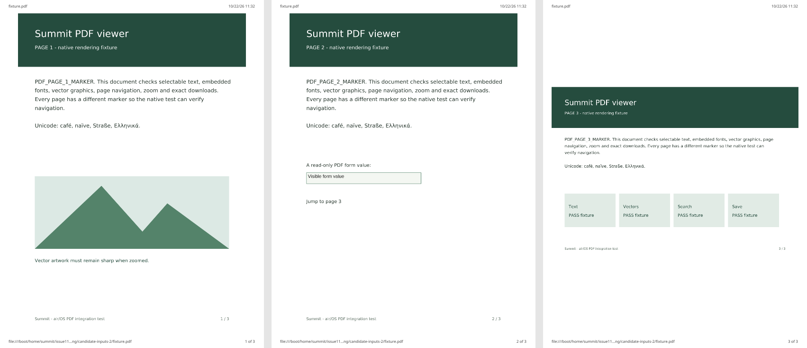
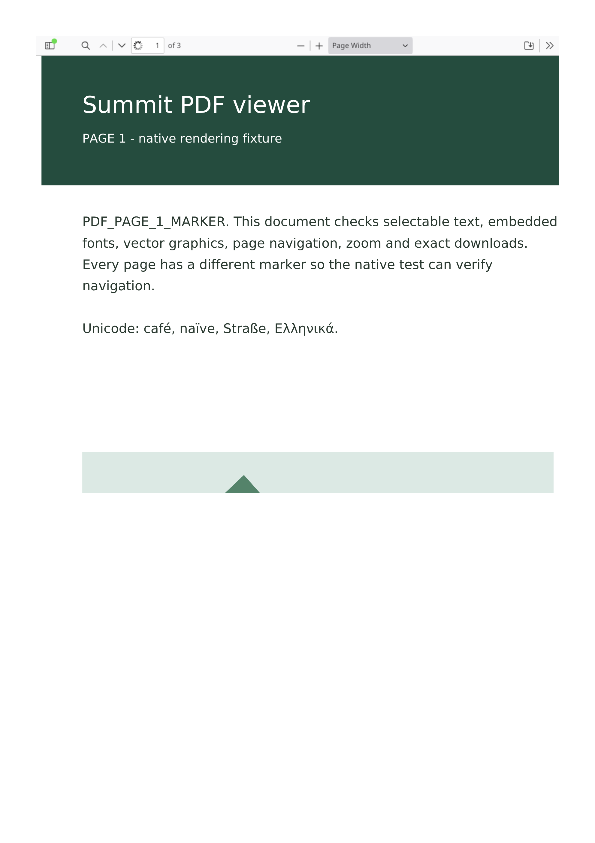

# PDF viewing

Summit displays inline `application/pdf` responses in tabs and embedded
`object`, `embed`, and `iframe` elements using
WebKit's bundled PDF.js viewer. The toolbar provides page navigation, zoom,
search, outlines, and downloading the original PDF. Password-protected PDFs
prompt for their password. Damaged or empty files display an error in the viewer.

This is a reader: PDF JavaScript and annotation editing are disabled. Existing
annotations and form appearances remain visible. The print buttons and
File → Print print the PDF's document pages. A server response with `Content-Disposition: attachment`
continues to use Summit's download manager directly.

## Native PDF printing (#110, 22 October 2026)

Printing uses the PDF already loaded by the viewer, including its decrypted
contents after a password has been supplied. PDF.js renders the requested pages
serially into a private canvas. The engine fits each page, preserving its aspect
and intrinsic rotation, into the chosen paper and margins. It leaves the visible
page, zoom and scroll position alone. The toolbar request retains its frame
identity, so an embedded PDF prints its own pages. Print jobs reject a changed
navigation, invalid ranges and excessive allocations; suspended renders time out
after 30 seconds and release their document references.

The existing `DrawPagesForPrinting()` entry point remains available. The new
`DrawFramePagesForPrinting()` also accepts the requesting frame and expected
load generation. Ordinary HTML continues through the existing print layout.
PDF output from this print API contains rasterized pages at 200 dpi; the native
printer path uses its selected resolution, capped at 200 dpi. Use the viewer's
download action to save the original PDF with its text and vector content.

The isolated airOS x86_64 engine passes **69 native assertions** covering all
three pages, exact page-range and toolbar pixel equality, overflowed ranges,
stale and unknown frames, allocation rejection, repeated printing, embedded PDFs,
locked/unlocked and invalid PDFs, HTML pagination, and navigation during a
deliberately suspended render. The complete browser also prints three pages
through both File → Print and a native pointer click on the PDF toolbar.
Haiku's Preview driver reports **“of 3 Pages”** for both jobs. Each spool decodes
to three page pictures, with the form value, footer and landscape page intact:



An independent MuPDF comparison of the direct raster output has mean absolute
RGB differences below 2.1/255 on each page. The form appearance was also inspected
in the native spool; MuPDF's `show_pdf_page` comparison omits widgets. The final
probe and full browser exit normally, leave no helpers, and preserve their
input/runtime hashes, with complete crash-log intervals and no debugger events.
[The native record](pdf-printing-native-2026-10-22.json) includes the engine,
runtime hashes, print spool measurements and development failures.

`tests/NativePDFPrintSpoolTests.cpp` decodes the three-page fixture's native spool
into PPM images (`SPOOL_FILE OUTPUT_DIRECTORY`, link with `-lbe`). This acceptance
uses Haiku's Preview driver; a physical printer and PDF Writer were not tested.
The workstation's BFS failed one large artifact copy with `EFBIG`; the repeated
toolbar spool was streamed to the host and hash-verified before closing Preview.

## PDF printing baseline (#110, 22 October 2026)

The published `8224d7a` airOS x86_64 engine (`20261021.2246`) reproduces
the outstanding printing defect. Its viewer opens the three-page fixture,
but `DrawPagesForPrinting()` returns one page for both PDF and raster output.
Requesting page two returns no pixels. The print button is hidden and the
viewer reports that printing is unsupported.

The final native baseline passes 15 diagnostic assertions and exits normally
with no helpers left, unchanged input/runtime hashes, and no fresh debugger
event. A separate pypdf 6.19.0 read verifies that the source has three pages
and the output has one. Its extracted text includes the viewer's **Page
Width** control. The raster shows the toolbar and a clipped first page:



[`pdf-printing-baseline-2026-10-22.json`](pdf-printing-baseline-2026-10-22.json)
records the measurements and native runtime provenance before the fix.

`tests/ModernPDFPrintTests.cpp` calls the public native print API and saves
`printed.pdf`, raster pages, and `observed.json` into an owned output directory.
It accepts `URL OUTPUT_DIRECTORY ENGINE_BUNDLE INVENTORY_GATE baseline|candidate`.
Serve the generated three-page fixture over loopback, compile with the matching
engine headers and `-lWebKit -lbe -lnetwork`, and use an isolated engine/profile.
After it reports `PDF_PRINT_READY`, inspect its loaded libraries and create the
inventory-gate file to continue. The explicit `baseline` mode asserts the
old defect; `candidate` exercises the corrected API and lifecycle checks above.
Use the probe from baseline commit `4c79c3b` when compiling against the old
engine, whose public API predates `DrawFramePagesForPrinting()`.

Simply unhiding the buttons is insufficient: the bundled PDF.js print service
cleans up its prepared pages after its native print call returns, while Summit
opens the native print dialog asynchronously. The Haiku integration captures the
native print entry point before PDF.js replaces it and keeps independent render
state for each native request until its pages have been consumed.

## Response and resource handling

The top-level PDF stays at its original URL, preserving navigation, history,
and the browser's certificate display. `PDFJSDocument` transfers the response
bytes already loaded by WebKit into its viewer frame. It does not fetch the
document again, so authenticated requests and private browsing use their
existing network context. The viewer's Save action passes the PDF's original
bytes to the native download manager.

PDF.js comes from the pinned WebKit source tree (`Source/ThirdParty/pdfjs`),
including its worker, fonts, character maps, localization, and WebAssembly
resources. The Haiku build compresses these resources into the engine. No CDN,
extension installation, or external PDF application is required.

The `webkit-pdfjs-viewer` resource loader accepts only compiled resource paths
for PDF viewer frames. It does not interpret URL paths as filesystem paths.
Haiku-specific configuration and styles live outside the vendored PDF.js
distribution, under `Source/WebCore/Modules/pdfjs-extras/haiku` in the engine
patch. The bundle includes PDF.js's upstream license.

The Haiku engine configuration defaults `ENABLE_PDFJS` to `ON`. The released
engines are configured from `engine/arm64/rpi4-gl/init-cache-rtc.cmake`, whose
forced values override that default, so the init cache turns it on too (see
issue #78 below). When reusing an engine build directory that previously
cached it as `OFF`, reconfigure with `-DENABLE_PDFJS=ON` before building and
freezing a browser bundle.

## Native verification

`tools/bench/pdf-fixture.py` creates a three-page PDF with embedded Unicode
fonts, vector artwork, a read-only form, an internal link, and a landscape
page. It also serves encrypted, scripted, authenticated, attachment, damaged,
and empty variants. Fixture generation requires ReportLab and pypdf; Poppler
can render the generated PDFs for visual inspection.

`tests/ModernPDFTests.cpp` runs against a frozen native bundle in an isolated
private WebKit context. Its public Inspector session reads the actual PDF
iframe, and native mouse messages operate the viewer's toolbar. Downloads
are compared byte-for-byte with the original fixture, and the harness waits
for its own WebKit helpers to exit before reporting completion.

`tests/ModernBrowserPDFTests.cpp` additionally checks the full browser's
address, title, Save button, reload, Back, and persisted history. It creates a
unique download filename and removes only that verified fixture afterwards.

Build the harness with the bundle's `source/include` headers, the repository's
`vendor` include directory, and `-lWebKit -lbe`. Run it with:

```text
test-pdf BASE_URL OWNED_DOWNLOAD_DIRECTORY BUNDLE GOLDEN_PDF SCREENSHOT_PPM
```

Set `WEBKIT_EXEC_PATH` to the bundle and `LIBRARY_PATH` to its private libraries
(preceded by the workstation's Mesa prefix when applicable). Set
`SUMMIT_ENABLE_INPUT_SYNTHESIS=1` for the native pointer checks. The download
directory, fixture path, and screenshot path must be absolute paths owned by
the test run.

Verified on X399 with frozen bundle `bundle-xqmj4o2b`: 86 engine checks and
32 full-browser checks passed. The engine patch SHA-256 was
`cd91bc86ed6603dfb56b7b43a74ad2bdb5ad77a351b9920c3b838e833e5294c7`.
Both successful runs exited without remaining helpers or new crash reports.
Native screenshots were inspected for the standalone view and browser tab.
The saved fixture was 29,604 bytes, with SHA-256
`c9dc0cea9bdc6361f9d2e85b14879c907d46574c6fb234d88822c771ecf61b0f`.
The five host tests and JavaScript syntax checks also passed.

The standalone harness attaches its Inspector after the initial navigation
finishes, matching the browser's Developer Tools lifecycle. PDF.js remembers
the page for a previously viewed document; repeated fixture visits explicitly
select page one before checking its pixels and text.

## Webmail blob attachments (9 October 2026)

Blob attachments inherit their creator's CSP policy container. The CSP
`frame-ancestors` navigation check must allow local URLs (`blob:`, `data:`,
and `about:`), as specified in [CSP's navigation response check](https://w3c.github.io/webappsec-csp/#frame-ancestors-navigation-response).
Applying a webmail page's `frame-ancestors` header to its own PDF blob instead
produced an empty, sandboxed error document. Both WebCore and network-process
ancestor checks now apply the local-URL exception. Other inherited policies
remain active, including script restrictions; HTTP responses still enforce
`frame-ancestors`, and the embedding page still enforces `object-src` and
`frame-src`.

The PDF fixture now serves a webmail-style HTTP CSP with `frame-ancestors
'none'`. The native suite exercises blob PDFs in all three embedding elements,
blocked HTTP PDFs, explicitly blocked blob embeds, and inherited HTML blob
script restrictions. The private customer PDF used for workstation verification
is not included in the repository.

Verified in `bundle-b46l7ic6`: 107 native PDF checks pass, including the new
webmail cases and existing rendering, navigation, search, zoom, encryption,
byte-exact saving and resource isolation checks. The previous installed build
fails at the first inherited-CSP blob attachment. Evidence is in
`.vm/fixes-2026-10-09/pdf-{baseline,final}-tests.log`.

The 32 full-browser PDF checks also pass in this bundle. After installation
and restart through the normal desktop launcher, the customer's original
attachment renders directly in Proton Mail; both pages were visually checked
through VNC. The signed-in email session was restored. Screenshots and private
fixture files remain under the ignored `.vm/fixes-2026-10-09/` directory.

## Released engines without PDF.js (issue #78, 20 October 2026)

Proton Mail's attachment preview said "This browser does not support
previewing PDF documents. Please download the file." In the same builds a
link to a PDF downloaded the file instead of opening it in a tab, and `embed`
and `iframe` elements with a PDF stayed blank. Pages were told the opposite:
`navigator.pdfViewerEnabled` was true and `navigator.plugins` listed the five
PDF viewers of the HTML specification.

Every `summit_webkit` package CI has built lacked PDF.js. airos-ci's
`summit/build-engine.sh` configures the engine for every target (air/OS
x86_64, arm64, and stock Haiku R1/beta6) from
`engine/arm64/rpi4-gl/init-cache-rtc.cmake`. That file is a cache dump of the
Raspberry Pi's engine build, and it forced `ENABLE_PDFJS` to `OFF`, which
overrides `OptionsHaiku.cmake`'s default. The 9 October checks above used an
engine built in the VM, which had PDF.js. Without PDF.js,
`WebLocalFrameLoaderClient::objectContentType` finds nothing that shows
`application/pdf`, so Proton's `<object>` displays its fallback content. That
fallback is an `<embed>` of the same blob, which cannot show it either, and
then the notice. The `navigator` values come from
`WebLocalFrameLoaderClient::canShowMIMEType`, which was a stub that answered
yes for every type.

- The init cache turns `ENABLE_PDFJS` on. This changes `cmakeconfig.h`, so the
  next CI engine build rebuilds nearly the whole engine. The PDF.js viewer,
  worker, fonts, character maps and WebAssembly come from the WebKit tree
  (`Source/ThirdParty/pdfjs`, part of CI's sparse checkout). They are compiled
  into `libWebKit.so.1`, which grows by 3.4 MB stripped (149.2 to 152.6 MB),
  and the package needs no new files.
- Engine, Haiku only (`WebProcess/WebCoreSupport/WebLocalFrameLoaderClient.cpp`):
  for PDF types, `canShowMIMEType` now answers what the page can really show
  (`WebPage::canShowMIMEType`: PDF.js built in and its preference on). Other
  types still answer yes. `navigator.pdfViewerEnabled`, `plugins` and
  `mimeTypes` now follow the engine: true, five plugins, and `application/pdf`
  and `text/pdf` with PDF.js; false and empty lists without it. Sites can then
  offer a download instead of an empty preview.
- `tests/EngineOptions.cmake` (ctest `summit_engine_options`) fails when the
  init cache turns off PDF.js or another feature Summit relies on. The
  Fullscreen API was off in the same way until issue #55.

`tools/bench/pdf-fixture.py` serves `/webmail-preview`, a copy of Proton's
preview. It sends Proton Mail's CSP, whose `frame-ancestors` leaves out the
mail site itself. The page reads the fetched bytes into a `File`, calls
`createObjectURL`, builds `<object><embed><p>notice</p></object>` off the
document and then inserts it, as React does. With `order=late`, `data` is set
after insertion. `frame=1` runs the page in a same-origin iframe, and
`source=http` uses the PDF's HTTP address instead of the blob. The status line
and the title say `shown` or `fallback` and give the `navigator` values.
`tests/ModernPDFTests.cpp` loads all four variants.

Checked on the X399 with the browser of main `fbb1ae5` and test copies of the
CI tree's engine (`/boot/home/summit/claude-s36`):

- Released engine 0816: every preview variant shows the fallback notice, and
  `navigator` says `pdfViewerEnabled=true plugins=5 mimeTypes=2`. A PDF link
  downloads, and a blob PDF `embed` stays blank.
- CI's configuration with the `canShowMIMEType` change (test build `pdfn1`,
  still without PDF.js): `pdfViewerEnabled=false plugins=0 mimeTypes=0`. A PDF
  link still downloads.
- The same tree with `ENABLE_PDFJS` on and the change (`pdfe1`): all four
  preview variants show the PDF in the `object` with the viewer's toolbar
  (`document=application/pdf`), and the notice and the inner `embed` are not
  shown. The PDF link opens in a tab at its own address, and blob PDFs in
  `embed` and `iframe` render (screenshots). `attachment.pdf` downloads
  byte-identical to the original (SHA-256 `e7477fa2…`). The native suite
  passes all 120 checks, including the webmail previews and `navigator`, and
  its viewer Save downloads also match the original byte for byte.
