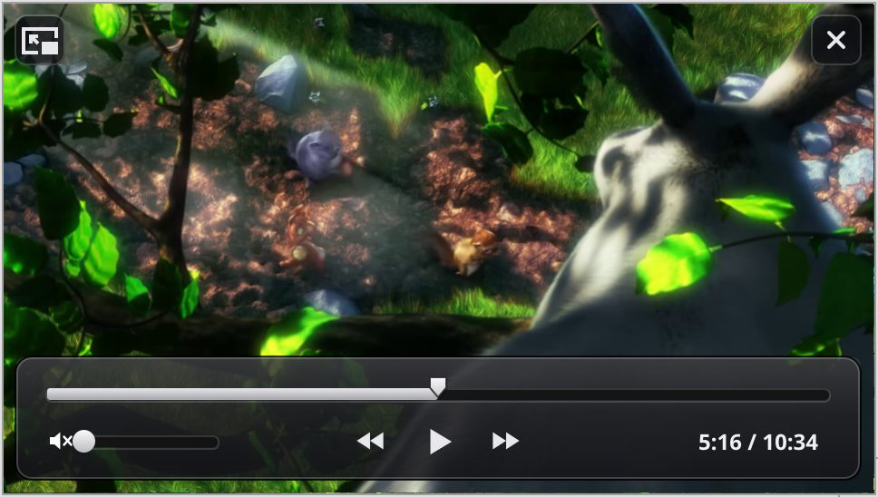

# Picture in Picture

A video can play in a small floating window above every other window, on all
workspaces, keeping the video's shape. It came in #74
([issue-fixes-2026-10-19b.md](issue-fixes-2026-10-19b.md)); #80 (20 October
2026) added a button on the video, airTime's controller over the picture and a
proper back-to-tab button.

## What the user sees

- **A Picture in Picture button on the video.** When the pointer is over a
  video that is big enough to be the page's video (at least 200x110 points,
  with its data loaded, 15 seconds or longer, or live), a small dark button
  with the Picture in Picture icon shows at the video's right edge, halfway
  down, as Firefox's does; under the pointer it widens to say "Picture in
  Picture". A click on it opens the window. It goes when the pointer leaves
  the video or rests for 3 seconds, while the page scrolls, and while that
  video is in the window. It is not shown for a video with
  `disablepictureinpicture`. It works where players cover the video with their
  own layers and take its right clicks (YouTube, also embedded in other
  pages), which is why the context menu's **Picture in Picture** was not
  enough.
- The other ways in are unchanged: the page's own button
  (`requestPictureInPicture()`), **Picture in Picture** on a video's context
  menu, **View › Picture in Picture** (Shift+Alt+P, the page's largest video).
- **The controller.** While the pointer is over the window (and when it
  opens), airTime's full screen controller lies over the bottom of the
  picture: dark glass, a timeline with the played part and the playhead,
  rewind, play/pause and fast forward, the speaker (a click mutes) with a
  volume slider, and the time ("0:16 / 0:30"; a click on it shows the time
  left). Rewind and fast forward skip 10 seconds; held down they keep skipping,
  five times a second. A click on the timeline seeks there, and dragging it
  scrubs. A live stream (or a video without its length yet) has no playhead
  and shows the time only. In smaller windows everything is scaled down
  (to 55%) and the volume slider, then the "/ duration", give way. The
  controller goes after 2.8 seconds without the mouse (not while the pointer
  rests on it, or on a paused picture) and at once when the pointer leaves
  the window.
- At the top: **back to the tab** (left) and **close** (right), dark glass
  squares. The back button now shows the usual "leave Picture in Picture"
  icon: the page's frame, the small picture in its bottom right corner and an
  arrow from it up into the frame. It selects the tab and ends Picture in
  Picture with the video still playing in the page.
- A click on the picture plays or pauses; dragging it moves the window.
  Keys: Space plays or pauses, Left and Right skip 10 seconds, Up and Down
  change the volume, M mutes.

## How it works

**The button** is part of the page script `kPictureInPictureScript`
(`src/ui/PageScripts.cpp`), which runs at document start in every frame in
the page's own world. A passive `mousemove` listener on the window notes the
pointer and, at most every 90 ms, looks for a video under it with
`document.elementsFromPoint` (which sees through the players' overlays), or,
for a video that takes no pointer events, by its box. The button lives in a
closed shadow root on a `<summit-pip-button>` element of its own, appended to
the document element (or to the fullscreen element, when that holds the
video): the host has fixed position, zero size, the highest z-index and
`all: initial` set with `!important` in its style, and the styles are an
adopted style sheet (not blocked by a page's CSP; YouTube's Trusted Types
rule out `innerHTML`, so everything is made with `createElement`). Showing,
hiding and moving it change only the shadow tree, so the page's layout and
its mutation observers never see it. Its pointer and mouse events are stopped
by listeners on the window in the capture phase, which run before any of the
page's (the script is the first to register them): the page never sees a
click on the button, and focus does not move. A click calls the script's own
`requestPictureInPicture` for that video, the same path as the page's API.

**The controller** is `PictureView` in `src/ui/PictureInPictureWindow.cpp`.
Its layout and drawing are airTime's `ControlBar` in `hud` mode and the
`look::` functions it uses (`hud_panel`, `timeline_track`, `playhead`,
`slider_track`/`slider_knob`, the glyphs), scaled by
`min(width / 520, height / 292)` between 0.55 and 1; the glass is a little
see-through (alpha 224) because it lies over the picture. With the controls
showing, the picture and the controls are drawn into a bitmap of the window's
size in device pixels (with `SetScale` of the display scale), which is then
drawn in one step, so the video never shows through them and they reach a
200% screen one to one. Two app_server details matter there: a shape is drawn
offset by the pen position (which `StrokeLine` and `DrawString` move), and it
is scaled by the scale of the current state only, so the drawing code resets
the pen before each shape and never uses `PushState`. The icons are shapes on
whole points, which cover exactly their area at 100% and 200%.

What the user does goes to the browser window as `kPictureInPictureCommand`
and from there to the engine with `BWebKitView::PictureInPictureCommand`
(`BrowserWindow::PictureInPictureCommand` passes the media commands on). The
window shows the result at once (the button's state, the seek target, the
volume) and keeps it for a moment against frames that were already on their
way.

**The engine** (`WebProcess/WebPage/haiku/WebPageHaiku.cpp`) knows these
commands, all run as the user's own action:

| Command | Effect |
| --- | --- |
| `play`, `pause`, `toggle` | as before |
| `seek:<seconds>` | `currentTime` set to that time |
| `skip:<seconds>` | forward by that much, back when negative (at most a day) |
| `volume:<0-1>` | the volume |
| `mute`, `unmute` | `muted` |

Seeks are kept within the video's seekable range (else 0 to its duration).
Anything else, a number that does not parse or is not finite, or a volume
outside 0-1 is ignored; the browser only passes on commands of these forms
and under 40 characters. The frames (`B_WEBKIT_PICTURE_IN_PICTURE_FRAME`) now
carry `volume` and `muted` beside `paused`, `time` and `duration`, and are
sent when any of them changed, at most 30 a second. A seek also sends frames
for half a second (15 ticks) whatever changed, and one more when the video's
`seeking` ends, so that a paused video shows the picture at the new time,
not only the new time. The commands are documented in `WebKitView.h`. With an
older engine the new commands do nothing and the window shows volume 1.

## Checked

On the X399 (NVIDIA, 200%), with test engine `pipe1` (CI's tree with the two
staged files) and the test copy `bundle-pip5`, by real pointer input over VNC:

- The button appears over a plain `<video>` page and over a YouTube watch
  page (whose overlays cover the video) and in an embedded YouTube iframe; a
  click opens the window, and the page's own `mousedown`/`click` listeners
  saw nothing of it. Not shown over a `disablepictureinpicture` video, nor
  over the video while it is in the window.
- Each control, on the plain video and on YouTube (MSE): pause and play,
  fast forward and rewind (±10 s, also while paused, with the picture
  updated), held rewind (four skips in a second), a click on the timeline at
  three quarters (22.5 of 30 s) and, on YouTube, at its middle (316.6 of 634 s), dragging the
  timeline and the volume slider, the volume (0.50), mute and unmute, the
  time display toggle; the page's `seeked`/`volumechange` events and the
  engine's media report matched. The time and playhead move while playing
  (frames a second apart: 5:28, 5:29, 5:30).
- Back to the tab and close; dragging the picture moved the window without
  pausing; a click on it paused. The controller hides after 2.8 s.
- The frame buffer (fbcap) at 200%, and at 100% (`SUMMIT_DEVICE_SCALE_FACTOR=1`,
  shown enlarged): the icons and the controller are crisp; windows of 240x135
  and 160x90 points get the scaled-down controller.

Not tried: the keys (the X399's desktop is shared, so no keystrokes were
sent), the button in full screen.
